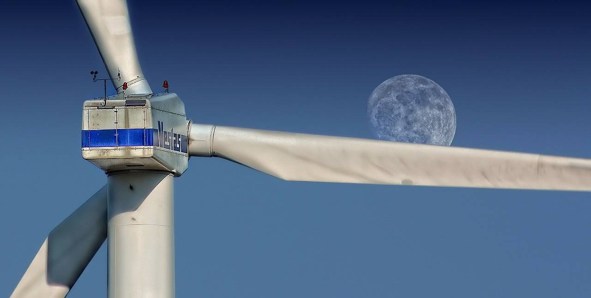

# [Power System Optimization Dispatch] Low-carbon Dispatch of Wind Power Systems Considering Uncertainties on both Sides of Source and Load (Matlab Code Implementation)

[Power System Optimized Dispatching]Low-carbon Dispatching of Wind Power System Considering Uncertainties on both Sides of Source and Load (Matlab Code Implementation)

## Images

<!-- PAYMENT_BLOCK -->

## Get this dataset

- Payment link (Stripe): [Buy now](https://buy.stripe.com/3cs8yP7sY87d0vu9AB)
- Payment QR code: 

<!-- /PAYMENT_BLOCK -->
